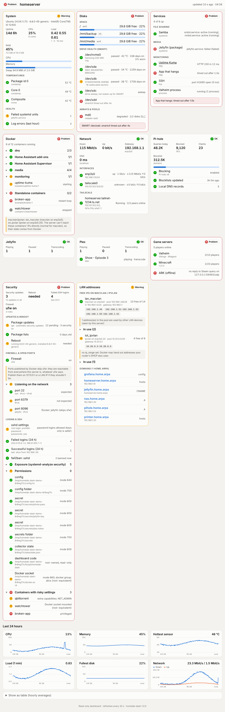
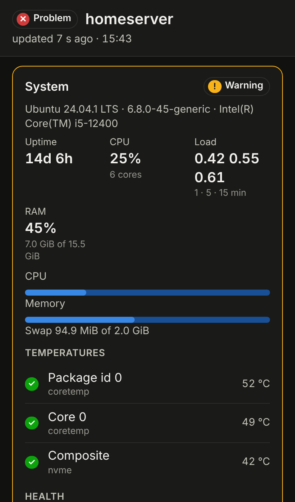

# homelab-dash

A **read-only** home lab dashboard for a Linux server: one web page with the health of
the server and the services on it. It is written in the Python standard library only:
no pip, no Docker, no Node and no build step.

| Desktop (fake demo data) | Phone, dark mode |
|---|---|
|  |  |

## How it works

```
 systemd timer (60 s)                         phone / PC (LAN or Tailscale)
        │                                                ▲
        ▼                                                │ GET only, fixed paths
 homelab-dash-collector.service  ──writes──▶  /var/lib/homelab-dash/   ◀──reads── homelab-dash-web.service
 root, but sandboxed:                         status.json  history.json             DynamicUser, no capabilities,
 read-only FS, 2 capabilities,                (state.json: root-only)               port 8088, LAN + Tailscale only
 private networks only, idle priority
```

* **Collector** (`collect.py`): runs every check once, writes `status.json` and a rolling
  24-hour `history.json`, then exits. Every check has a timeout, and every card runs in its own thread
  with a deadline. A broken check shows an error **on its own card** and never blanks the page.
* **Web server** (`serve.py`): serves 11 fixed paths (the page, its assets and the two JSON
  files). It has no directory listing, no user input and no query parsing, and it only answers GET and HEAD.
* **Page** (`web/`): mobile-first and can be added to the home screen. It refreshes every 30 s and whenever you
  switch back to it. It shows **Data is stale** after 3 minutes and **Can't load data** when a request fails or
  times out (10 s). It has a 24-hour history with tooltips and an hourly table.
* **Detector** (`detect.py`): run once while installing. It reads the host (OS, CPU, RAM, drives,
  sensors, firewall, LAN subnet, Tailscale), finds systemd services, Docker Compose stacks,
  sidecars (`network_mode: container:`/`service:`), Home Assistant add-ons, macvlan/ipvlan networks
  and LinuxGSM servers, and writes a draft config for you to review.

## Cards

| Card | Shows |
|---|---|
| System | OS, kernel, CPU model, uptime, CPU %, load, RAM/swap, every temperature sensor, failed systemd units, error-level log lines in the last hour |
| Disks | free space per filesystem; SMART health, temperature, wear and bad sectors per drive (cached for 30 min, never wakes sleeping disks); mdadm/ZFS state |
| Services | up/down for systemd units, HTTP endpoints, TCP ports, processes (for example LinuxGSM) and single containers |
| Docker | every container grouped by Compose stack; sidecars and the container they borrow their network from (if a VPN container like gluetun is down, its sidecars turn red); add-ons; macvlan IPs; health, restart loops, crashes vs. clean stops |
| Network | interfaces, addresses, live throughput, gateway, DNS lookup, Tailscale state and peers |
| Pi-hole | queries, % blocked, clients, blocklist size, blocking on/off (v5 and v6; re-uses one session) |
| Jellyfin / Emby / Plex | playing / paused / transcoding counts (titles and users only if you opt in) |
| Game servers | online/offline and player counts via Steam query (A2S) or Minecraft ping, plus an optional process check |

## Start here

1. Read **[docs/INSTALL.md](docs/INSTALL.md)** (or jump to its *TL;DR* for the interactive `quillwort.sh` installer): one command per step, each with a check, a dry run before the timer goes on, and the full **rollback**.
2. Follow **[docs/TEST-PLAN.md](docs/TEST-PLAN.md)**: offline tests, install checks, a 24-hour soak and a reboot test.
3. Every config option is in **[config/config.example.ini](config/config.example.ini)**.

Try it on fake data first, with no install and no root:

```bash
python3 -m unittest discover -s tests          # 64 offline tests
python3 tests/demo.py                          # http://127.0.0.1:8088/ with a made-up server
```

## Security summary

* Nothing on the page can change the server: no buttons, no logins, no forms. The server only answers GET and HEAD.
* `systemd-analyze security`: collector **2.4 OK**, web **0.9 SAFE** (1.0 with your LAN allow-list).
* Secrets are typed with `read -s` into root-only (600) files. They are never on the command line, in the config, in the JSON or on the page.
  Or keep them in an **Ansible vault** and load them into RAM only: see [docs/SECRETS-FROM-VAULT.md](docs/SECRETS-FROM-VAULT.md).
* Access is limited to your LAN subnet and Tailscale in **two** places: the firewall, and systemd's `IPAddressAllow=` on the web unit.
* Host-header allow-list against DNS rebinding; strict Content-Security-Policy; all text is rendered with `textContent`.
* The collector only sends `GET` to the Docker socket and can't reach the Internet (`IPAddressAllow` = private ranges).

## Layout

```
collect.py serve.py detect.py   entry points (run with python3 -I -B)
unlock.py                       optional: load secrets from an Ansible vault into RAM
quillwort.sh                    optional: interactive quick installer (see INSTALL.md, TL;DR)
homelab_dash/                   collector, checks, web server, detector
web/                            index.html, app.js, style.css, manifest, icons
systemd/                        collector .service + .timer, web .service
config/config.example.ini       every option, commented
tests/                          offline tests, fake system, demo
docs/                           INSTALL.md (incl. rollback), TEST-PLAN.md, SECRETS-FROM-VAULT.md
```
